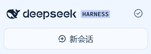
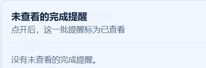

# 会话完成提示 · dsh-session-completion

同时跑多个 DeepSeek Harness 会话时，不用逐个点开确认进度。这个插件在左侧栏顶部加一个圆形勾号，集中显示**尚未查看、正常结束的会话**。打开提醒面板即可清除这一批角标，点会话标题就能回到原对话。

[安装](#安装) · [使用](#使用) · [卸载](#卸载) · [GitHub 仓库](https://github.com/xForMe/dsh-session-completion)

> **「完成」表示 Harness 正常结束了一轮回复，不代表任务结果已经验收，也不代表测试通过。**

## 安装

本插件是面向 **DeepSeek Harness Web 界面**的第三方插件，不适用于 TUI 或无界面模式。下面的打包步骤和 CLI 参数已在 Windows、DSH `0.2.2-rc.5`、Node.js `24.13.1` 环境下核对；尚未确定最低兼容版本，也未在新配置中实测完整安装流程。

1. 用 Git 和 npm 获取源码、打成本地安装包。没有构建步骤，也不需要先运行 `npm install`。

   ```powershell
   git clone https://github.com/xForMe/dsh-session-completion.git
   cd dsh-session-completion
   npm pack
   ```

2. 如果你使用 `dsh web` 启动 Harness，在同一个 PowerShell 中运行以下命令。示例文件名对应插件 `1.0.3`；如果版本变了，使用 `npm pack` 输出的文件名。若你启动时用的是另一个 Web 配置，将 `web` 替换成那个配置名。

   ```powershell
   $bundle = (Resolve-Path './local-dsh-session-completion-1.0.3.tgz').Path
   dsh plugin --profile web add $bundle
   ```

3. 重启该 Harness 实例，打开宽版左侧栏，查看顶部是否出现圆形勾号。用一个普通会话发条短消息，等待回复正常结束，图标上应出现数字角标。

**使用桌面版？** 桌面应用的配置不一定是 CLI 的 `web` 配置。若桌面版的「设置 → 插件」支持从本地包安装，请在那里面选择上一步生成的 `.tgz`。不要假设安装到 CLI 的 `web` 配置就会在桌面版生效。

## 使用

1. **看角标。** 数字表示未查看的会话数，每个会话最多一条。提醒按完成时间从新到旧排列。

   

2. **点圆形勾号。** 面板打开时会把当前这一批提醒标为已查看，列表会保留到面板关闭。打开期间新产生的提醒不会被这次操作清除。

   

3. **回到会话。** 列表有提醒时，点击会话标题即可跳转。也可以按 `Esc` 关闭面板，已查看的提醒不会在下次打开时重复出现。

插件只跟踪普通会话自身最近一轮的正常完成时间。运行中、空白、已归档、失败或中断的会话不显示提醒，子 Agent 和从父会话继承的旧轮次也不计入。开始新一轮时，旧完成状态会被清除。插件不是任务历史列表，不发送系统通知。

## 卸载

如果装在 CLI 的 `web` 配置中，运行下面的命令，再重启对应实例。桌面版请从安装时使用的插件管理页移除或停用 `@local/dsh-session-completion`。

```powershell
dsh plugin --profile web remove '@local/dsh-session-completion'
```

反馈问题请到 [GitHub Issues](https://github.com/xForMe/dsh-session-completion/issues)，附上 Harness 版本、安装方式和复现步骤。请勿提交密钥或私密会话内容。

## 许可证

仓库目前没有 `LICENSE` 文件，尚未声明开源许可证。
